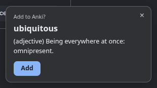

<div align="center">

# Auto Anki

**Google `ephemeral meaning`. Click Add. Get the card on every device.**

A tiny Chrome extension that spots "word meaning" searches and offers to turn the word into an Anki flashcard,<br>
with definitions, part of speech and an example sentence.




</div>

---

## Why

You already look words up by googling them. Adding them to Anki by hand is the step that never happens. Auto Anki turns it into one click, right where you already are.

## How it works

```
 You google:  ephemeral meaning
                   │
                   ▼
 ┌──────────────────────────────┐   reads the URL only,
 │ Auto Anki (service worker)   │   never the page content
 └──────────────┬───────────────┘
                │ "ephemeral"
                ▼
   Wiktionary  ──►  definitions + example
                │
                ▼
   "Add to Anki?" card on the results page
                │  you click Add
                ▼
   AnkiConnect (Anki desktop)  ──►  card in deck "Auto Anki"
                │  ~1 min later
                ▼
   AnkiWeb sync  ──►  AnkiDroid / AnkiMobile / other computers
```

The Anki card looks like this:

| Front | Back |
|---|---|
| ephemeral | 1. *(adjective)* Lasting for a short period of time.<br>2. *(adjective)* Existing for only one day, as with some flowers, insects, and diseases.<br>3. *(adjective)* Usually dry, but filling with water for brief periods during and after precipitation. |

## Features

- **One click.** Search as you always do. A small card asks "Add to Anki?" and shows the definition, so you can decide. Ignore it or close it with ×, and nothing is added.
- **Syncs everywhere.** Triggers an AnkiWeb sync about a minute after adding, batched so a burst of words syncs once.
- **Never loses a word.** Anki closed or offline when you click Add? The word is queued and added automatically once Anki is back.
- **No duplicates.** Adding a word that is already in the deck just says "Already in Anki".
- **Works with any Anki language.** Uses its own "Auto Anki" note type, created on first use. Your existing note types and decks are never touched.
- **Private by design.** Only reads Google search URLs. No analytics, no accounts, no servers of its own.
- **Tiny.** About 270 lines, zero dependencies, no build step.

## Quick start

**1. Install AnkiConnect in Anki desktop**

`Tools` > `Add-ons` > `Get Add-ons...` > enter code **`2055492159`** > restart Anki.

**2. Log in to AnkiWeb once** (only needed for syncing to other devices)

Click `Sync` in Anki desktop and sign in.

**3. Load the extension in Chrome**

```bash
git clone <this repo> auto-anki
```

Open `chrome://extensions`, enable **Developer mode**, click **Load unpacked** and pick the `auto-anki` folder.

**4. Try it.** With Anki open, google `ephemeral meaning`. The "Add to Anki?" card appears in the bottom right. Click **Add**, and the card is in the **Auto Anki** deck.

## What gets picked up

The query must be the word (or a phrase of up to 3 words) followed by `meaning`. Quotes are optional.

| You search | Card offered for |
|---|---|
| `ephemeral meaning` | `ephemeral` |
| `"ephemeral" meaning` / `'ephemeral' meaning` / `“ephemeral” meaning` | `ephemeral` |
| `Ephemeral MEANING` | `ephemeral` |
| `break the ice meaning` | `break the ice` |
| `self-aware meaning` | `self-aware` |

| Ignored | Why |
|---|---|
| `meaning of life` | doesn't end with `meaning` |
| `what does ephemeral mean` | different pattern (maybe later) |
| `ephemeral meaning in hindi` | extra words after `meaning` |
| `four words phrase here meaning` | more than 3 words |
| `covid19 meaning` | digits and symbols aren't words |
| `qwzxvk meaning` | not in Wiktionary (badge shows `?`) |
| google.de, google.kz, ... | only `google.com` for now |
| Bing, DuckDuckGo, ... | Google only for now |

The same word is offered at most once every 10 minutes, so reloading the results page doesn't nag you.

## Badge legend

| Badge | Meaning |
|---|---|
|  | Card added |
|  | Already in Anki, skipped |
|  | No definition found, nothing offered |
|  | Anki or the dictionary wasn't reachable (word queued, retried every 5 minutes and on your next search), or Anki returned an error |

Hover the extension icon to see which word the badge is about, and the exact error.

## Syncing to your phone

Auto Anki asks Anki desktop to sync about a minute after the last card it added. Your phone gets the card the next time it syncs (open AnkiDroid / AnkiMobile and sync, or turn on auto sync there).

Anki desktop must be running when you click Add. If it isn't, the word waits in the queue and is added and synced the next time Anki is open.

## Troubleshooting

<details>
<summary><b>The "Add to Anki?" card doesn't appear</b></summary>

- Check that the URL is on `www.google.com` (not a country domain) and the query ends with `meaning`.
- Check that the word exists on [en.wiktionary.org](https://en.wiktionary.org). Unknown words show `?` on the badge.
- You already saw the card for that word in the last 10 minutes.
- Open the logs (below) for errors.
</details>

<details>
<summary><b>"Couldn't reach Anki or the dictionary" even though Anki is open</b></summary>

1. Check AnkiConnect is answering:
   ```bash
   curl -s localhost:8765 -d '{"action":"version","version":6}'
   # {"result": 6, "error": null}
   ```
2. Check Wiktionary is reachable from your network: open <https://en.wiktionary.org/api/rest_v1/page/definition/ephemeral>.
3. Hover the extension icon: the tooltip shows the exact error.
</details>

<details>
<summary><b>Cards don't show up on my phone</b></summary>

Make sure Anki desktop is logged in to AnkiWeb (click `Sync` once), then sync on the phone. The extension's sync runs about a minute after the last added card. If it fails, Anki still syncs on close when *Automatically sync on profile open/close* is on.
</details>

<details>
<summary><b>Where are the logs?</b></summary>

`chrome://extensions` > Auto Anki > **Inspect views: service worker** > Console.
</details>

## Development

No dependencies, no build. Node 20+ for the tests.

```bash
npm test
```

```
auto-anki/
├── manifest.json      # MV3 manifest
├── background.js      # wires Chrome events to src/flow.js
├── src/
│   ├── parse.js       # Google URL -> word, or null
│   ├── dictionary.js  # Wiktionary lookup, HTML -> text
│   ├── toast.js       # the "Add to Anki?" card (injected into the page)
│   ├── card.js        # HTML for the back of the Anki card (escaped)
│   ├── anki.js        # AnkiConnect client: note type, addWord, sync
│   └── flow.js        # glue: dedupe, confirm, badge, queue, sync alarm
└── test/              # node:test, network and chrome.* stubbed
```

After changing the code, click the reload icon on the extension card in `chrome://extensions`.

## Roadmap

- [ ] More query patterns: `define X`, `X definition`, `what does X mean`
- [ ] Google country domains, Bing and DuckDuckGo
- [ ] Popup with recent words and settings (deck name, on/off)
- [ ] Pronunciation and audio on the card
- [ ] Other languages and translation cards
- [ ] Extension icon

## License

[MIT](LICENSE)
